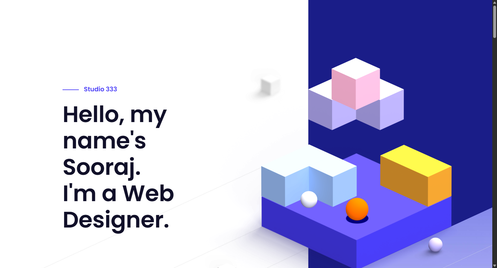
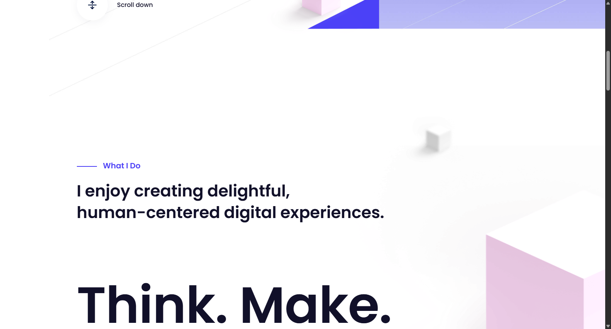
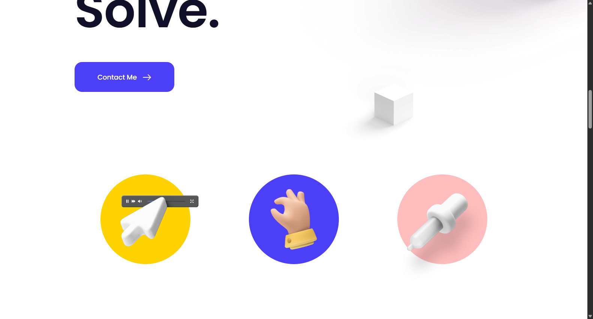

# Portfolio-1

<p align="center">
  
  
  
  
  
</p>

An interactive digital product & UI/UX portfolio website featuring 3D isometric floating cubes, responsive parallax depth scrolling, case study sliders, and dark aesthetic layouts.

---

## 📸 Hero Preview

<p align="center">
  
</p>

## 🖼️ UI Snapshot Gallery

<p align="center">
  
  
</p>

---

## ✨ Features

- 🧊 **Isometric 3D Cube Parallax** - Dynamic multi-layered 3D geometry that reacts to viewport cursor movement and scrolling.
- 📱 **Interactive Case Studies** - Touch-friendly responsive carousel showcasing featured digital products and client work.
- ✨ **AOS Scroll Reveals** - Smooth fade-and-slide entry animations for cards, typography, and image assets.
- 🎨 **Dark Aesthetic Design System** - High-contrast typography with neon accents and clean negative space.
- ⚡ **Lightweight & Fast** - Pure front-end architecture with minimal overhead and instantaneous page loads.

---

## 🛠️ Tech Stack

- **Core**: HTML5, CSS3, JavaScript (ES6)
- **Libraries**: SimpleParallax, Owl Carousel, AOS (Animate on Scroll), Fancybox

---

## 🚀 Quick Start

### 1. Clone the repository
```bash
git clone https://github.com/soorajstudio/Portfolio-1.git
cd Portfolio-1
```

### 2. Run locally
```bash
# Using Python
python -m http.server 8080

# Or using Node
npx serve .
```

Open [http://localhost:8080](http://localhost:8080) in your browser.

---

## 📄 License

This project is licensed under the MIT License — see the [LICENSE](LICENSE) file for details.

Developed with ❤️ by [Sooraj Studio](https://github.com/soorajstudio).
